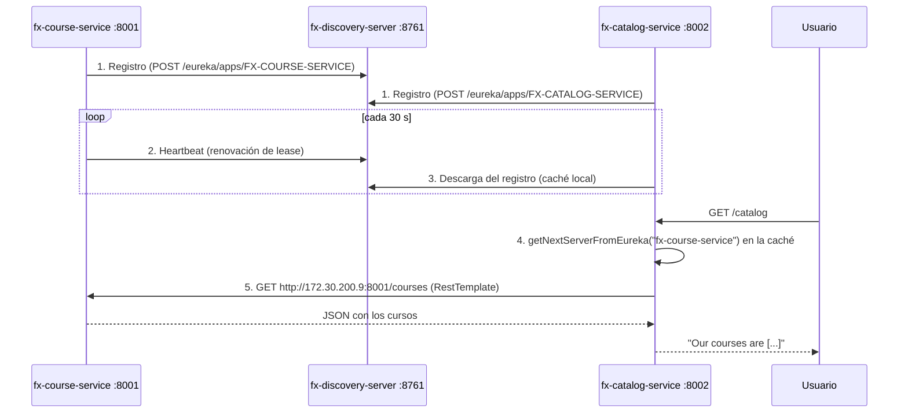

# Parte 1 — Service Discovery con Eureka

> Criterio de calificación (40%): explicar cómo `fx-catalog-service` descubre y se comunica con `fx-course-service`, y demostrarlo con los endpoints.

Estado: **completa**. El código original funciona sin modificaciones (verificado el 2026-10-22, evidencia abajo).

---

## 1. Arquitectura

| Servicio | `spring.application.name` | Puerto | Rol |
|---|---|---|---|
| `fx-discovery-server` | `fx-discovery-server` | 8761 | **Servidor Eureka**: el registro donde los servicios se anotan y se buscan |
| `fx-course-service` | `fx-course-service` | 8001 | **Proveedor**: CRUD de cursos (JPA + H2 en memoria, 3 cursos de ejemplo) |
| `fx-catalog-service` | `fx-catalog-service` | 8002 | **Consumidor**: arma el catálogo pidiéndole los cursos a `fx-course-service` |



---

## 2. Cómo funciona, paso a paso

### 2.1 El servidor Eureka (`fx-discovery-server`)

`FutureXEurekaServerApplication` tiene `@EnableEurekaServer`, que levanta el registro y el panel web en el 8761. En `application.properties`:

```properties
server.port=8761
eureka.client.register-with-eureka=false   # el servidor no se registra a sí mismo
eureka.client.fetch-registry=false         # ni descarga el registro (él ES el registro)
```

### 2.2 Los clientes se registran (`fx-course-service`, `fx-catalog-service`)

Ambos tienen la dependencia `spring-cloud-starter-netflix-eureka-client`. Con eso, Spring Cloud los registra automáticamente al arrancar; no hace falta `@EnableDiscoveryClient`. Lo que se configura:

```properties
spring.application.name=fx-course-service                      # nombre con el que otros lo buscan
server.port=8001
eureka.client.service-url.defaultZone: http://localhost:8761/eureka/   # dónde está Eureka
```

Al arrancar, cada cliente:

1. **Se registra**: envía a Eureka su nombre, IP, puerto y URL base (`homePageUrl`).
2. **Manda heartbeats** cada 30 s. Si Eureka deja de recibirlos (90 s por defecto), saca la instancia del registro.
3. **Descarga el registro completo** y lo guarda en una caché local, que refresca cada 30 s.

Log real de `fx-course-service` al registrarse:
```
DiscoveryClient_FX-COURSE-SERVICE/172.30.200.9:fx-course-service:8001 - registration status: 204
```

### 2.3 El catálogo descubre al servicio de cursos (`CatalogController`)

`fx-catalog-service/src/main/java/com/futurex/services/FutureXCourseCatalog/CatalogController.java`:

```java
@Autowired
private EurekaClient client;                       // inyectado por el starter de Eureka

@RequestMapping("/catalog")
public String getCatalog() {
    InstanceInfo instanceInfo = client.getNextServerFromEureka("fx-course-service", false);
    String courseAppURL = instanceInfo.getHomePageUrl();   // "http://172.30.200.9:8001/"
    courseAppURL = courseAppURL + "/courses";
    RestTemplate restTemplate = new RestTemplate();
    courses = restTemplate.getForObject(courseAppURL, String.class);
    return ("Our courses are " + courses);
}
```

- `getNextServerFromEureka("fx-course-service", false)`: busca en la **caché local** (no llama a Eureka en cada request) las instancias registradas con ese nombre. El segundo parámetro, `false`, significa que la búsqueda es HTTP y no HTTPS. Si hay varias instancias, las devuelve en **round-robin**: cada llamada toma la siguiente, lo que da un balanceo de carga básico.
- `getHomePageUrl()` devuelve la URL base real de la instancia: IP y puerto.
- `RestTemplate.getForObject(...)` hace la llamada HTTP normal.
- El nombre `"fx-course-service"` tiene que coincidir **exactamente** con el `spring.application.name` del servicio de cursos.

### 2.4 Mapeo de endpoints

| Catálogo (8002) | Llama a course (8001) | Respuesta |
|---|---|---|
| `GET /` | `GET /` | `"Welcome to FutureX Course Catalog " + "Course App Home"` |
| `GET /catalog` | `GET /courses` | `"Our courses are " + JSON con los 3 cursos` |
| `GET /firstcourse` | `GET /1` | JSON deserializado al DTO `Course` del catálogo → `"Our first course is " + nombre` |

### 2.5 Por qué importa (vs. URL fija)

El propio código conserva la versión anterior, comentada:

```java
//String courseAppURL = "http://localhost:8080/courses";
```

| URL fija | Con Eureka |
|---|---|
| Si el servicio cambia de host o puerto, hay que recompilar el consumidor | El consumidor solo conoce el **nombre lógico** |
| Una sola instancia | Varias instancias, con round-robin automático |
| No sabe si el destino está vivo | Eureka retira las instancias que dejan de mandar heartbeat |

---

## 3. Evidencia (ejecución real, 2026-10-22, JDK 17)

**Panel / registro de Eureka** (`GET http://localhost:8761/eureka/apps`):
```
FX-CATALOG-SERVICE  172.30.200.9:fx-catalog-service:8002  UP  http://172.30.200.9:8002/
FX-COURSE-SERVICE   172.30.200.9:fx-course-service:8001   UP  http://172.30.200.9:8001/
```

**Endpoints del catálogo**:
```
GET http://localhost:8002/            → 200
Welcome to FutureX Course Catalog Course App Home

GET http://localhost:8002/catalog     → 200
Our courses are [{"courseid":1,"coursename":"Spring Boot Fundamentals","author":"John Doe"},{"courseid":2,"coursename":"Advanced Java Programming","author":"Jane Smith"},{"courseid":3,"coursename":"Microservices Architecture","author":"Bob Johnson"}]

GET http://localhost:8002/firstcourse → 200
Our first course is Spring Boot Fundamentals
```

---

## 4. Observaciones encontradas al probar

1. **Ventana de arranque (~15-30 s).** Justo después de levantar el catálogo, los 3 endpoints dieron 500 con:
   ```
   java.lang.RuntimeException: No matches for the virtual host name :fx-course-service
   ```
   El catálogo todavía no tenía a `fx-course-service` en su caché local, porque el servidor Eureka cachea sus respuestas y el cliente refresca cada 30 s. A los 17 s respondió 200 sin hacer nada. Esto muestra que el descubrimiento es **eventualmente consistente**.

2. **La doble barra `//` no rompe nada, pero por suerte.** `getHomePageUrl()` ya termina en `/`, así que el código arma `http://...:8001//courses`. Llamado directamente, ese path da 404:
   ```
   GET http://localhost:8001//courses → 404
   ```
   Funciona porque `RestTemplate` normaliza la URL antes de enviarla. El log de error muestra que la petición real fue a `http://172.30.200.9:8001/courses`, con una sola barra. No se modificó el código, pero es un detalle a mencionar.

3. **`mvnw` no tenía permiso de ejecución en git (modo 100644).** `./mvnw` fallaba con `permission denied`. Se corrigió (modo 100755), así que ahora `./mvnw spring-boot:run` funciona directo; `sh mvnw ...` también sirve.

4. **Java.** Se probó con JDK 17, la versión del `pom.xml`. Spring Boot 3.3.3 soporta Java 17 a 22. Si el `java` por defecto es más nuevo:
   ```bash
   JAVA_HOME=$(/usr/libexec/java_home -v 17) sh mvnw spring-boot:run
   ```

---

## 5. Limitación que motiva la Parte 2

Con `fx-course-service` apagado, el catálogo no degrada con gracia: **revienta con 500**.

```
GET http://localhost:8002/catalog → 500
ResourceAccessException: I/O error on GET request for "http://172.30.200.9:8001/courses": Connection refused
```

Eureka todavía lista la instancia caída hasta que vence su lease (unos 90 s) y el catálogo refresca su caché, así que el catálogo sigue intentando llamarla. No hay timeout, reintento ni respuesta alternativa. Eso es lo que resuelve el **Circuit Breaker con Resilience4j** (Parte 2): fallar rápido y devolver un fallback en vez de un error.

---

## 6. Guion de demo

1. Levantar en orden, cada uno en su terminal:
   ```bash
   cd fx-discovery-server && sh mvnw spring-boot:run
   cd fx-course-service   && sh mvnw spring-boot:run
   cd fx-catalog-service  && sh mvnw spring-boot:run
   ```
2. Abrir http://localhost:8761: mostrar `FX-COURSE-SERVICE` y `FX-CATALOG-SERVICE` en UP.
3. Esperar unos 30 s y abrir:
   - http://localhost:8002/
   - http://localhost:8002/catalog
   - http://localhost:8002/firstcourse
4. Mostrar `CatalogController` y explicar `getNextServerFromEureka` → `getHomePageUrl` → `RestTemplate` (sección 2.3).
5. Cerrar: apagar `fx-course-service`, recargar `/catalog` y ver el 500, que es el problema que resuelve la Parte 2.
