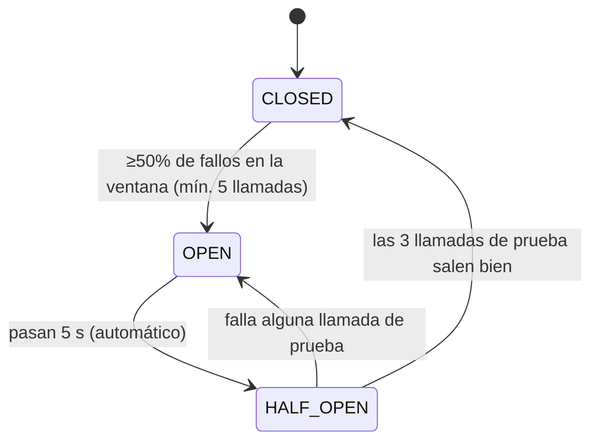

# Parte 2 — Circuit Breaker con Resilience4j

> Criterio de calificación (60%): configuración de Resilience4j, fallbacks, anotaciones en el controlador, propiedades, demostración del Circuit Breaker y otros patrones de resiliencia, explicación de Resilience4j y de Hystrix.

Estado: **implementada y verificada** el 2026-10-22 con JDK 17 (evidencia en la sección 5). RateLimiter, Bulkhead y TimeLimiter agregados y verificados el 2026-10-25 (sección 3.2).

---

## 1. El problema (viene de la Parte 1)

Sin resiliencia, si `fx-course-service` cae, `fx-catalog-service` responde **HTTP 500** con un stack trace (`ResourceAccessException: Connection refused`). Además, cada request sigue intentando conectarse al servicio muerto.

En un sistema real eso produce **fallas en cascada**: los hilos del consumidor quedan esperando a un servicio que no responde, se agota el pool y el consumidor también cae, aunque su propio código esté bien.

---

## 2. Qué se implementó (solo en `fx-catalog-service`)

### 2.1 Dependencias — `fx-catalog-service/pom.xml`

```xml
<dependency>
    <groupId>org.springframework.cloud</groupId>
    <artifactId>spring-cloud-starter-circuitbreaker-resilience4j</artifactId>
</dependency>
<dependency>
    <groupId>org.springframework.boot</groupId>
    <artifactId>spring-boot-starter-aop</artifactId>   <!-- las anotaciones funcionan con aspectos -->
</dependency>
<dependency>
    <groupId>io.github.resilience4j</groupId>
    <artifactId>resilience4j-bulkhead</artifactId>   <!-- @Bulkhead: el starter NO lo incluye -->
</dependency>
<dependency>
    <groupId>org.springframework.boot</groupId>
    <artifactId>spring-boot-starter-actuator</artifactId>  <!-- monitoreo (opcional del enunciado) -->
</dependency>
```

Las versiones las gestiona el BOM de Spring Cloud 2023.0.3 (Resilience4j 2.1.0). El starter ya trae `resilience4j-retry`, `-ratelimiter` y `-timelimiter`; `-bulkhead` hay que agregarlo a mano.

### 2.2 Propiedades — `fx-catalog-service/src/main/resources/application.properties`

**Circuit Breaker** (valores exactos del enunciado):

| Propiedad | Valor | Significado |
|---|---|---|
| `slidingWindowSize` | 10 | Evalúa las últimas 10 llamadas |
| `minimumNumberOfCalls` | 5 | No calcula la tasa de fallo hasta tener al menos 5 llamadas |
| `failureRateThreshold` | 50 | Si ≥50% fallan → **OPEN** |
| `waitDurationInOpenState` | 5s | Tiempo en OPEN antes de probar de nuevo |
| `automaticTransitionFromOpenToHalfOpenEnabled` | true | Pasa a HALF_OPEN solo, sin esperar una request |
| `permittedNumberOfCallsInHalfOpenState` | 3 | Llamadas de prueba en HALF_OPEN |
| `registerHealthIndicator` | true | Publica el estado en `/actuator/health` |
| `eventConsumerBufferSize` | 10 | Eventos guardados para `/actuator/circuitbreakerevents` |
| `ignoreExceptions` | `RequestNotPermitted`, `BulkheadFullException` | Rechazos de nuestro propio RateLimiter/Bulkhead: no son fallas de course, no deben abrir el circuito |

**Retry** (patrón adicional):

| Propiedad | Valor | Significado |
|---|---|---|
| `maxAttempts` | 3 | 1 intento + 2 reintentos |
| `waitDuration` | 500ms | Espera entre intentos |
| `ignoreExceptions` | `CallNotPermittedException`, `RequestNotPermitted`, `BulkheadFullException` | Si una capa interna rechazó la llamada **sin intentarla** (circuito OPEN, límite de tasa, bulkhead lleno), no reintenta: va directo al fallback |

**RateLimiter**, **TimeLimiter** y **Bulkhead** (patrones adicionales, detalle en la sección 3.2):

| Propiedad | Valor | Significado |
|---|---|---|
| `ratelimiter...limitForPeriod` | 5 | Máximo 5 llamadas a course por período |
| `ratelimiter...limitRefreshPeriod` | 1s | Duración del período |
| `ratelimiter...timeoutDuration` | 0 | Sin permiso, rechaza al instante (no hace esperar a la request) |
| `ratelimiter...subscribeForEvents` | true | Publica eventos en `/actuator/ratelimiterevents` (por defecto viene apagado) |
| `timelimiter...timeoutDuration` | 2s | Deja de esperar a course a los 2 s; cuenta como fallo para el circuito |
| `thread-pool-bulkhead...coreThreadPoolSize` / `maxThreadPoolSize` | 2 / 2 | Máximo 2 llamadas simultáneas a course |
| `thread-pool-bulkhead...queueCapacity` | 1 | 1 más en espera; la 4ª simultánea se rechaza |

Los valores del Bulkhead y del RateLimiter son **chicos a propósito** para poder demostrarlos en local con `curl`. En producción se dimensionan según la capacidad real de course.

**Timeouts del `RestTemplate`** (bean en `FutureXCourseCatalogApplication`): `connectTimeout=1s`, `readTimeout=3s`. Antes cada método hacía `new RestTemplate()` sin timeouts; ver por qué hacen falta en la sección 3.2.

**Actuator**: expone `health`, `circuitbreakers`, `circuitbreakerevents`, `retries`, `retryevents`, `ratelimiters`, `ratelimiterevents`, `timelimiters`, `timelimiterevents`, `bulkheads` y `bulkheadevents`.

### 2.3 Anotaciones y fallbacks — `CatalogController.java`

Los 3 endpoints que llaman a `fx-course-service` quedan protegidos. Todos comparten la instancia `courseService`, es decir, **un circuito por dependencia**: si course cae, se abre para los tres.

```java
@RequestMapping("/catalog")
@Retry(name = "courseService", fallbackMethod = "fallbackGetCatalog")
@CircuitBreaker(name = "courseService")
@RateLimiter(name = "courseService")
@TimeLimiter(name = "courseService")
@Bulkhead(name = "courseService", type = Bulkhead.Type.THREADPOOL)
public CompletableFuture<String> getCatalog() {
    /* código original: Eureka + restTemplate.getForObject(...) */
    return CompletableFuture.completedFuture("Our courses are "+courses);
}

public CompletableFuture<String> fallbackGetCatalog(Exception ex) {
    return CompletableFuture.completedFuture("Fallback: Unable to retrieve course catalog ("+reason(ex)+")");
}
```

Los métodos devuelven `CompletableFuture<String>` porque `@TimeLimiter` lo exige (sección 3.2). Spring MVC lo resuelve solo: el cliente sigue recibiendo un `String`.

| Endpoint | Fallback | Respuesta degradada |
|---|---|---|
| `/` | `fallbackGetCatalogHome` | `Welcome to FutureX Course Catalog. Fallback: course service unavailable (...)` |
| `/catalog` | `fallbackGetCatalog` | `Fallback: Unable to retrieve course catalog (...)` |
| `/firstcourse` | `fallbackGetSpecificCourse` | `Fallback: Unable to retrieve first course (...)` |

El paréntesis indica el motivo:

| Motivo | Quién lo produce | ¿Se llamó a course? |
|---|---|---|
| `retries exhausted: ResourceAccessException` | Retry, tras 3 intentos con course caído | Sí, 3 veces |
| `retries exhausted: TimeoutException` | Retry, tras 3 intentos que superaron los 2 s del TimeLimiter | Sí, 3 veces |
| `circuit OPEN, call not attempted` | CircuitBreaker | No |
| `rate limit exceeded, call not attempted` | RateLimiter | No |
| `bulkhead full, call not attempted` | Bulkhead | No |

**Reglas del fallback:** mismo tipo de retorno que el método protegido (`CompletableFuture<String>`), mismos parámetros (aquí ninguno) y la excepción como último parámetro. Debe estar en la misma clase. En el camino asíncrono la excepción puede llegar envuelta en `CompletionException`; `reason()` la desenvuelve.

**Decisión de diseño: por qué el fallback va en `@Retry` y no en otra anotación.**
Resilience4j aplica los aspectos en este orden: `Retry( CircuitBreaker( RateLimiter( TimeLimiter( Bulkhead( método ) ) ) ) )`. Retry es la capa externa.
- Si el fallback estuviera en `@CircuitBreaker` (o en cualquier capa interna), ese fallback "tragaría" la excepción y devolvería un String normal. Retry vería un éxito y **nunca reintentaría**.
- Con el fallback en `@Retry`, cada intento fallido se registra en el circuito, y solo cuando se agotan los reintentos (o el circuito está OPEN) se devuelve la respuesta degradada.

**Sobre `Resilience4JConfig` (paso 5 opcional del enunciado): incluida, con su alcance verificado.**
`Resilience4JConfig.java` define el `Customizer<Resilience4JCircuitBreakerFactory>` del enunciado: ventana 2, espera 1 s, umbral 50%.

Spring ofrece dos formas de usar Circuit Breaker, y cada una lee su configuración de un lugar distinto:

| Forma | Cómo se usa | Lee su configuración de |
|---|---|---|
| **Anotaciones** (la que usa `CatalogController`) | `@CircuitBreaker(name="courseService")` | `resilience4j.circuitbreaker.instances.*` en `application.properties` |
| **Programática** (Spring Cloud CircuitBreaker) | `circuitBreakerFactory.create("id").run(() -> llamada, ex -> fallback)` | El `Customizer` de `Resilience4JConfig` |

Por eso la clase **no cambia** el comportamiento de los endpoints. Queda como configuración por defecto para cualquier circuito que se cree desde código.

Verificado con `Resilience4JConfigTests` (2 tests, ambos en verde):
```
annotationsUsePropertiesNotCustomizer  → courseService: slidingWindowSize=10, minimumNumberOfCalls=5, waitDuration=5000ms  (properties)
programmaticFactoryUsesCustomizer      → factory.create("programmaticDemo"): slidingWindowSize=2, waitDuration=1000ms   (Resilience4JConfig)
```

---

## 3. Cómo funciona el Circuit Breaker



- **CLOSED**: todo normal; las llamadas pasan y se cuentan éxitos y fallos.
- **OPEN**: no se llama a course. Se lanza `CallNotPermittedException` y se responde el fallback **inmediatamente** (0 ms en vez de esperar timeouts).
- **HALF_OPEN**: deja pasar 3 llamadas de prueba para ver si course se recuperó.

---

## 3.1 Cómo funciona Retry (segundo patrón)

**Qué resuelve.** Muchas fallas son **transitorias**: un paquete perdido, un servicio que se está reiniciando, un pico de carga de 200 ms. Si el primer intento falla, repetirlo poco después suele funcionar. Retry hace eso de forma automática, así que el usuario no ve un error que se habría resuelto solo.

**Configuración** (`resilience4j.retry.instances.courseService.*`):
- `maxAttempts=3`: hasta 3 intentos en total (1 original + 2 reintentos).
- `waitDuration=500ms`: espera fija entre intentos, para no martillar al servicio.
- `ignoreExceptions=CallNotPermittedException` (+ `RequestNotPermitted`, `BulkheadFullException`, sección 3.2): si una capa interna rechazó la llamada sin intentarla, no reintenta.

Fuera de esos rechazos, Retry reintenta ante **cualquier excepción**: conexión rechazada, `TimeoutException`, un 500 de course y también los 4xx. No se filtró más por tipo para mantener la demo simple.

**Flujo de una request con course caído y el circuito CLOSED:**
```
t=0.0s    intento 1 → CircuitBreaker → RestTemplate → Connection refused   (CB registra fallo 1)
          espera 500 ms
t=0.5s    intento 2 → CircuitBreaker → RestTemplate → Connection refused   (CB registra fallo 2)
          espera 500 ms
t=1.0s    intento 3 → CircuitBreaker → RestTemplate → Connection refused   (CB registra fallo 3)
          intentos agotados → fallbackGetCatalog(ex) → "Fallback: ... (retries exhausted: ResourceAccessException)"
```
Esto coincide con la evidencia: la request tardó **1.03 s** y el circuito registró **3 fallos**.

**Flujo con el circuito OPEN:**
```
t=0.0s    intento 1 → CircuitBreaker rechaza → CallNotPermittedException
          Retry la ignora (no reintenta) → fallback → "Fallback: ... (circuit OPEN, call not attempted)"
```
Tarda **0.00 s**. Reintentar contra un circuito abierto no tiene sentido: el circuito ya decidió que course está caído.

**El circuito se puede abrir a mitad de una request** (observado):
```
intento 1 → Connection refused → el circuito llega al umbral y se abre (80% de fallos)
espera 500 ms
intento 2 → CallNotPermittedException → Retry la ignora → fallback "circuit OPEN"   [0.51 s]
```
Retry no gasta el tercer intento: en cuanto el circuito se abre, corta.

**Cómo se complementan.**
- **Retry** resuelve fallas **cortas**: insiste un poco.
- **Circuit Breaker** resuelve fallas **largas**: deja de insistir.
- Sin Circuit Breaker, Retry multiplicaría la carga sobre un servicio caído (3 llamadas por request).
- Sin Retry, un error momentáneo llegaría directo al usuario.
- Juntos: Retry absorbe los errores puntuales y, si los fallos siguen, cada intento fallido alimenta al Circuit Breaker, que abre el circuito y corta todo.

**Orden de las anotaciones.** Resilience4j aplica `Retry( CircuitBreaker( método ) )`: Retry es la capa externa. El fallback va solo en `@Retry` (ver la decisión de diseño en la sección 2.3). Si fuera en `@CircuitBreaker`, ese fallback devolvería un String "exitoso" y Retry nunca vería el error, así que nunca reintentaría.

Se comprobó moviendo **temporalmente** el fallback de `/catalog` a `@CircuitBreaker` (y luego revirtiendo). La prueba arrancó con el circuito CLOSED y course caído:

| | Fallback en `@Retry` (implementado) | Fallback en `@CircuitBreaker` (prueba) |
|---|---|---|
| Tiempo de respuesta | 1.01 s | 0.002 s |
| Eventos de reintento | 2 `RETRY` + 1 `ERROR` | **0** |
| Fallos registrados en el circuito | 3 | 1 |

Con el fallback en `@CircuitBreaker`, `@Retry` queda puesto pero no hace nada.

**Monitoreo** (verificado):
- `GET /actuator/retries` → `{"retries":["courseService"]}`
- `GET /actuator/retryevents` → un evento por intento:

| Evento | Significado |
|---|---|
| `RETRY` | Intento fallido que se va a repetir (`numberOfAttempts` = 1, 2) |
| `ERROR` | Intentos agotados (`numberOfAttempts=3`); se ejecuta el fallback |
| `IGNORED_ERROR` | Excepción que no se reintenta (`CallNotPermittedException` con el circuito OPEN) |

Ejemplo real (course caído, una request):
```
11:57:38.018 RETRY  attempts=1 ResourceAccessException: I/O error on GET ...
11:57:38.525 RETRY  attempts=2 ResourceAccessException: I/O error on GET ...
11:57:39.028 ERROR  attempts=3 ResourceAccessException: I/O error on GET ...
11:57:39.569 IGNORED_ERROR    CallNotPermittedException: CircuitBreaker 'courseService' is OPEN ...
```

---

## 3.2 RateLimiter, Bulkhead y TimeLimiter (patrones 3, 4 y 5)

Retry y Circuit Breaker reaccionan a un course **caído** (responde error). Estos tres cubren lo que falta: un course **lento** o **colgado**, y un catálogo que se protege a sí mismo de la sobrecarga.

### La cadena completa

```
request
  └─ Retry            reintenta fallas transitorias (fallback aquí)
      └─ CircuitBreaker   corta si course falla seguido
          └─ RateLimiter      máx. 5 llamadas/s a course
              └─ TimeLimiter      deja de esperar a los 2 s
                  └─ Bulkhead (thread pool)  máx. 2 simultáneas + 1 en cola
                      └─ método: Eureka + RestTemplate → course
```

Es el orden **por defecto** de Resilience4j; en el código las anotaciones están escritas en ese mismo orden para que se lea igual.

### RateLimiter: limitar la tasa de llamadas

**Qué resuelve.** Protege a course (y al catálogo) de picos: no importa cuántas requests lleguen, a course le llegan como máximo 5 por segundo. Las que sobran reciben el fallback al instante en vez de encolarse.

**Decisión: `timeoutDuration=0`.** Si no hay permiso, rechaza al momento. Con un valor > 0 la request esperaría un permiso libre, ocupando un hilo de Tomcat durante esa espera.

**Flujo** (course sano, 7 requests seguidas en el mismo segundo): las 5 primeras pasan, la 6ª y 7ª reciben `rate limit exceeded` en ~3 ms. El circuito sigue **CLOSED**.

### Bulkhead: aislar recursos

**Qué resuelve.** El nombre viene de los compartimentos estancos de un barco: si uno se inunda, el barco no se hunde. Aquí: si course se cuelga, solo se bloquean los 2 hilos del pool dedicado a course; los hilos de Tomcat quedan libres y el resto del catálogo (Actuator, otros endpoints) sigue respondiendo. Sin Bulkhead, un course colgado puede agotar los 200 hilos de Tomcat y tumbar al catálogo entero. Es la falla en cascada de la sección 1.

**Decisión: tipo `THREADPOOL` y no `SEMAPHORE` (el default).** Un semáforo solo limita la concurrencia y la llamada corre en el hilo de Tomcat. El thread pool además ejecuta la llamada **en otro hilo**, que es lo que necesita TimeLimiter (ver abajo).

**Capacidad:** 2 hilos + 1 lugar en cola = 3 llamadas en vuelo. La 4ª simultánea recibe `bulkhead full` al instante.

### TimeLimiter: cortar llamadas lentas

**Qué resuelve.** Un servicio **lento** es peor que uno caído: un servicio caído rechaza la conexión en milisegundos, pero uno colgado deja a la request esperando indefinidamente. TimeLimiter pone un tope de 2 s; pasado ese tiempo lanza `TimeoutException`, que cuenta como fallo para el circuito y para Retry.

**Decisión: los métodos devuelven `CompletableFuture`.** TimeLimiter solo puede "dejar de esperar" algo que corre en otro hilo. Si el método fuera síncrono, la llamada ya habría terminado (o seguiría bloqueada en el mismo hilo) antes de que TimeLimiter pudiera hacer nada. Por eso Resilience4j exige `CompletionStage` como tipo de retorno, y por eso el Bulkhead es THREADPOOL: ejecuta el cuerpo del método en su pool y devuelve el future que TimeLimiter vigila.

**Decisión: `readTimeout=3s` en el `RestTemplate`.** TimeLimiter deja de esperar, pero **no puede interrumpir** una lectura de socket bloqueada: el hilo del Bulkhead seguiría colgado. Sin `readTimeout`, cada timeout dejaría un hilo del pool ocupado para siempre y el Bulkhead quedaría lleno de forma permanente. El `readTimeout` (mayor que los 2 s del TimeLimiter, para no pisarlo) libera el hilo 1 s después.

### Por qué CircuitBreaker y Retry ignoran `RequestNotPermitted` y `BulkheadFullException`

Esos rechazos los genera **nuestro propio** throttling; course ni siquiera fue llamado.
- Si el circuito los contara como fallos, un pico de tráfico **con course sano** abriría el circuito y cortaría a todos los usuarios.
- Si Retry los reintentara, metería todavía más carga justo cuando estamos saturados.

### Evidencia (ejecución real, 2026-10-25)

Para simular un course **colgado** (no caído) se congeló el proceso con `kill -STOP <pid>`: el kernel sigue aceptando conexiones, pero nadie responde. `kill -CONT <pid>` lo reanuda.

**1) RateLimiter: course sano, 7 requests seguidas**
```
0.0109s Our courses are [{"courseid":1,"coursename":"Spring Boot Fundamentals",...
0.0093s Our courses are [...]
0.0090s Our courses are [...]
0.0092s Our courses are [...]
0.0094s Our courses are [...]
0.0054s Fallback: Unable to retrieve course catalog (rate limit exceeded, call not attempted)
0.0033s Fallback: Unable to retrieve course catalog (rate limit exceeded, call not attempted)
GET /actuator/ratelimiterevents → 6 SUCCESSFUL_ACQUIRE, 2 FAILED_ACQUIRE
CB state=CLOSED   (los rechazos no cuentan como fallos)
```

**2) Bulkhead: course congelado, 5 requests en paralelo**
```
0.004s  Fallback: ... (bulkhead full, call not attempted)     ← 4ª y 5ª: rechazadas al instante
0.004s  Fallback: ... (bulkhead full, call not attempted)
2.505s  Fallback: ... (circuit OPEN, call not attempted)      ← 3 aceptadas: TIMEOUT a los 2 s
2.505s  Fallback: ... (circuit OPEN, call not attempted)         → el circuito se abre
2.506s  Fallback: ... (circuit OPEN, call not attempted)         → Retry (500 ms) encuentra OPEN
GET /actuator/bulkheadevents → CALL_REJECTED x2
```
Las 3 llamadas aceptadas esperaron 2 s (TimeLimiter), los 3 timeouts abrieron el circuito y el reintento a los 500 ms ya lo encontró OPEN: tres patrones actuando en una sola ráfaga.

**3) TimeLimiter + Retry: course congelado, circuito en HALF_OPEN, 1 request**
```
7.008s  Fallback: Unable to retrieve course catalog (retries exhausted: TimeoutException)
GET /actuator/timelimiterevents:
  12:40:58.003 TIMEOUT    ← intento 1 (t=2.0s)
  12:41:00.505 TIMEOUT    ← intento 2 (t=4.5s = 2.0 + 0.5 espera + 2.0)
  12:41:03.006 TIMEOUT    ← intento 3 (t=7.0s)
CB: HALF_OPEN → OPEN
```
Sin TimeLimiter (y con el `RestTemplate` original sin timeouts) esa request habría quedado colgada indefinidamente.

**4) Recuperación:** `kill -CONT` → a los ~6 s `/catalog`, `/firstcourse` y `/` responden normal, circuito **CLOSED**.

**5) Regresión del flujo original** (course apagado, connection refused): sin cambios respecto a la sección 5.
```
1.014s  Fallback: ... (retries exhausted: ResourceAccessException)
1.016s  Fallback: ... (circuit OPEN, call not attempted)     ← se abrió a mitad de la request
0.003s  Fallback: ... (circuit OPEN, call not attempted)
```

---

## 4. Cómo Resilience4j mejora la resiliencia del sistema

1. **Evita fallas en cascada.** Con el circuito OPEN, el catálogo no gasta hilos ni conexiones en un servicio muerto, así que sigue sano y atendiendo.
2. **Falla rápido.** En la demo, la primera falla tardó ~1 s (3 intentos); con el circuito abierto, **0.00 s**.
3. **Degradación elegante.** El usuario recibe un mensaje controlado (fallback) y no un 500 con stack trace.
4. **Le da tiempo de recuperarse al servicio caído.** No lo bombardea con requests mientras está en problemas.
5. **Recuperación automática.** HALF_OPEN prueba solo y cierra el circuito cuando course vuelve, sin reiniciar nada.
6. **Tolera fallas transitorias** con Retry: un error momentáneo de red no llega al usuario.
7. **Observabilidad.** El estado, la tasa de fallos y los eventos se ven en Actuator.
8. **Tolera servicios lentos** con TimeLimiter: nadie espera más de 2 s a course.
9. **Aísla recursos** con Bulkhead: un course colgado solo bloquea su pool de 2 hilos, no los de Tomcat.
10. **Controla la carga** con RateLimiter: un pico de tráfico no se traslada completo a course.
11. **Ligero y modular.** Cada patrón es un módulo independiente que se configura por propiedades y se aplica con una anotación:

| Módulo | Anotación | Para qué |
|---|---|---|
| CircuitBreaker | `@CircuitBreaker` | Cortar llamadas a un servicio que falla ✅ *implementado* |
| Retry | `@Retry` | Reintentar fallas transitorias ✅ *implementado* |
| RateLimiter | `@RateLimiter` | Limitar llamadas por período ✅ *implementado* |
| Bulkhead | `@Bulkhead` | Limitar llamadas concurrentes (aislar recursos) ✅ *implementado (thread pool)* |
| TimeLimiter | `@TimeLimiter` | Cortar llamadas lentas (requiere `CompletableFuture`) ✅ *implementado* |

---

## 5. Evidencia (ejecución real, 2026-10-22)

Estado consultado en `GET /actuator/circuitbreakers` después de cada paso.

**1) Course UP → respuestas normales, circuito CLOSED**
```
GET /catalog → Our courses are [{"courseid":1,"coursename":"Spring Boot Fundamentals",...}]
CB state=CLOSED
GET /actuator/health → UP  {"state":"CLOSED","failureRateThreshold":"50.0%",...}
```

**2) Se apaga course → Retry, luego fallback, luego el circuito se abre**
```
GET /catalog → Fallback: Unable to retrieve course catalog (retries exhausted: ResourceAccessException)   real 1.03s
   CB state=OPEN failureRate=60.0% calls=5 failed=3
GET /catalog → Fallback: Unable to retrieve course catalog (circuit OPEN, call not attempted)            real 0.00s
   CB state=OPEN notPermitted=1
GET /catalog → ... (circuit OPEN, call not attempted)   real 0.00s   notPermitted=2
GET /catalog → ... (circuit OPEN, call not attempted)   real 0.00s   notPermitted=3
```
Una sola request generó 3 intentos (Retry, 2 × 500 ms ≈ 1 s), todos registrados como fallos en el circuito. Con los éxitos previos de la ventana, eso dio 60% de fallos ≥ 50%, y el circuito pasó a **OPEN**. Las siguientes requests responden en 0 ms sin tocar la red.

**3) Pasan 5 s → HALF_OPEN; course sigue caído → vuelve a OPEN**
```
CB state=HALF_OPEN
GET /catalog → Fallback: ... (retries exhausted: ResourceAccessException)
   CB state=OPEN failureRate=100.0%
```

**4) Se reinicia course → el circuito se cierra solo**
```
recovered after 21s   (tiempo que tarda course en re-registrarse y el catálogo en refrescar su caché de Eureka)
GET /catalog     → Our courses are [...]          CB state=HALF_OPEN
GET /            → Welcome to FutureX Course Catalog Course App Home
GET /firstcourse → Our first course is Spring Boot Fundamentals
   CB state=CLOSED
```

Health con el circuito abierto (`GET /actuator/health`):
```
global UP | circuitBreakers UNKNOWN | courseService state=OPEN   (HTTP 200)
```

Eventos (`GET /actuator/circuitbreakerevents`):
```
11:37:09 NOT_PERMITTED
11:37:10 STATE_TRANSITION OPEN_TO_HALF_OPEN
11:37:10 SUCCESS
11:37:10 SUCCESS
11:37:10 SUCCESS
11:37:10 STATE_TRANSITION HALF_OPEN_TO_CLOSED
```

**Observación:** durante la ventana de arranque del catálogo (unos 20 s en que Eureka todavía no lista a course), los errores `No matches for the virtual host name` también cuentan como fallos y pueden abrir el circuito. Es correcto: desde el punto de vista del catálogo, course no está disponible. Apenas aparece en el registro, el circuito pasa por HALF_OPEN a CLOSED solo.

---

## 6. Hystrix: cómo mejora la resiliencia y por qué ya no se usa

**Netflix Hystrix** fue la librería original de Circuit Breaker en el ecosistema Spring (Spring Cloud Netflix). Resuelve el mismo problema con estos mecanismos:

1. **Circuit Breaker.** Abre el circuito si en una ventana de 10 s hay al menos 20 requests (`requestVolumeThreshold`) y ≥50% fallan (`errorThresholdPercentage`). Tras 5 s (`sleepWindowInMilliseconds`) deja pasar una request de prueba.
2. **Fallback.** `@HystrixCommand(fallbackMethod = "...")`, con la misma idea que en Resilience4j.
3. **Aislamiento por thread pools (bulkhead).** Cada comando corre en su propio pool de hilos. Si una dependencia se cuelga, solo agota su pool y no los hilos del servidor web. Era su característica más fuerte.
4. **Timeouts por defecto** (1 s). Toda llamada lenta se corta y cuenta como fallo.
5. **Monitoreo** con Hystrix Dashboard y Turbine (agregado de métricas de muchos servicios).

```java
// Así se vería con Hystrix (Spring Boot 2.x, NO compila en este proyecto)
@HystrixCommand(fallbackMethod = "fallbackGetCatalog")
public String getCatalog() { ... }
```

**Por qué no se usa aquí:** Netflix lo puso en **modo mantenimiento en 2018**, y Spring Cloud lo **eliminó en la versión 2020.0**. No es compatible con Spring Boot 3 (Jakarta EE, Java 17). Netflix y Spring recomiendan Resilience4j como reemplazo.

### Resilience4j vs Hystrix

| Aspecto | Hystrix | Resilience4j |
|---|---|---|
| Estado | Mantenimiento desde 2018, sin soporte en Boot 3 | Activo, soporte oficial Spring Boot 3 / Spring Cloud |
| Diseño | Monolítico: todo pasa por `HystrixCommand` | Modular: se usa solo lo necesario |
| Aislamiento | Thread pool por comando (más overhead) | Semáforos por defecto; thread pool opcional (`@Bulkhead`) |
| Ventana del circuito | Por tiempo (10 s) | Por cantidad de llamadas **o** por tiempo, configurable |
| Patrones | Circuit breaker, fallback, timeout, bulkhead | Además Retry, RateLimiter, TimeLimiter, Cache |
| Configuración | Archaius / anotaciones | `application.properties`/`.yml`, por instancia |
| Monitoreo | Hystrix Dashboard + Turbine | Actuator + Micrometer (Prometheus/Grafana) |
| Peso | Dependencias pesadas (Archaius, RxJava) | Ligero, sin dependencias externas pesadas |

**Conclusión:** los dos implementan el mismo patrón y mejoran la resiliencia de la misma forma (cortar, fallar rápido, degradar, recuperarse). Resilience4j es el reemplazo moderno: más liviano, modular y compatible con el stack actual.

---

## 7. Guion de demo (Parte 2)

Con los 3 servicios arriba (ver el guion de la Parte 1):

1. `http://localhost:8002/catalog` → respuesta normal.
2. `http://localhost:8002/actuator/health` → `courseService` en **CLOSED**.
3. Detener `fx-course-service` (Ctrl+C en su terminal).
4. Recargar `/catalog`: tarda ~1 s (Retry) y muestra el fallback `retries exhausted`.
5. Recargar 1 o 2 veces más: el circuito pasa a **OPEN**, la respuesta es instantánea y dice `circuit OPEN, call not attempted`.
6. Ver `/actuator/health` → `courseService.state` = **OPEN**. El componente `circuitBreakers` queda `UNKNOWN` y el status global sigue `UP`: el catálogo está sano, solo su dependencia no. Luego `/actuator/circuitbreakerevents` → las transiciones.
7. Volver a levantar `fx-course-service` y esperar ~20-30 s (re-registro en Eureka).
8. Recargar `/catalog` → respuesta normal; `/actuator/health` → **CLOSED**.

**RateLimiter, Bulkhead y TimeLimiter** (con los 3 servicios arriba y el circuito CLOSED):

9. **RateLimiter**: ráfaga de 7 requests → 5 normales y 2 `rate limit exceeded`. Luego `/actuator/ratelimiterevents`.
   ```bash
   for i in $(seq 1 7); do curl -s localhost:8002/catalog | head -c 80; echo; done
   ```
10. Congelar course para simularlo **colgado**:
    ```bash
    kill -STOP $(pgrep -f FutureXCourseApp)
    ```
11. **Bulkhead**: 5 requests en paralelo → 2 `bulkhead full` al instante; las otras 3 cortan a los ~2.5 s. Luego `/actuator/bulkheadevents` (`CALL_REJECTED`).
    ```bash
    for i in $(seq 1 5); do (curl -s -w " %{time_total}s\n" localhost:8002/catalog) & done; wait
    ```
12. **TimeLimiter**: esperar ~6 s (circuito en HALF_OPEN) y pedir `/catalog` una vez → ~7 s y `retries exhausted: TimeoutException`. Luego `/actuator/timelimiterevents` (3 `TIMEOUT`).
13. Descongelar course y ver la recuperación (~6 s, circuito CLOSED):
    ```bash
    kill -CONT $(pgrep -f FutureXCourseApp)
    ```
